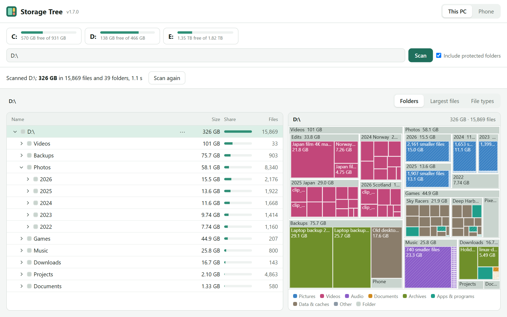
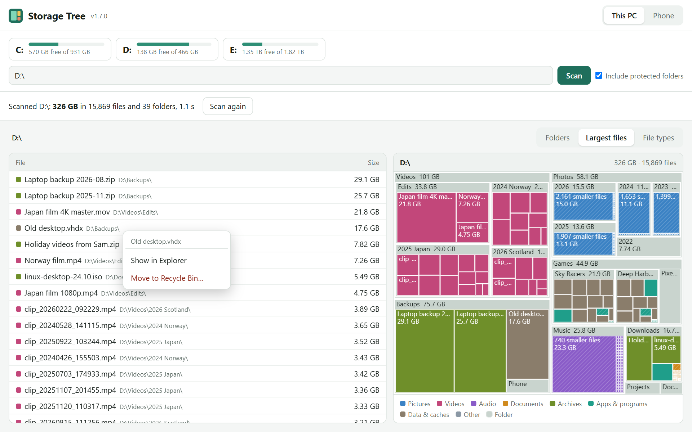
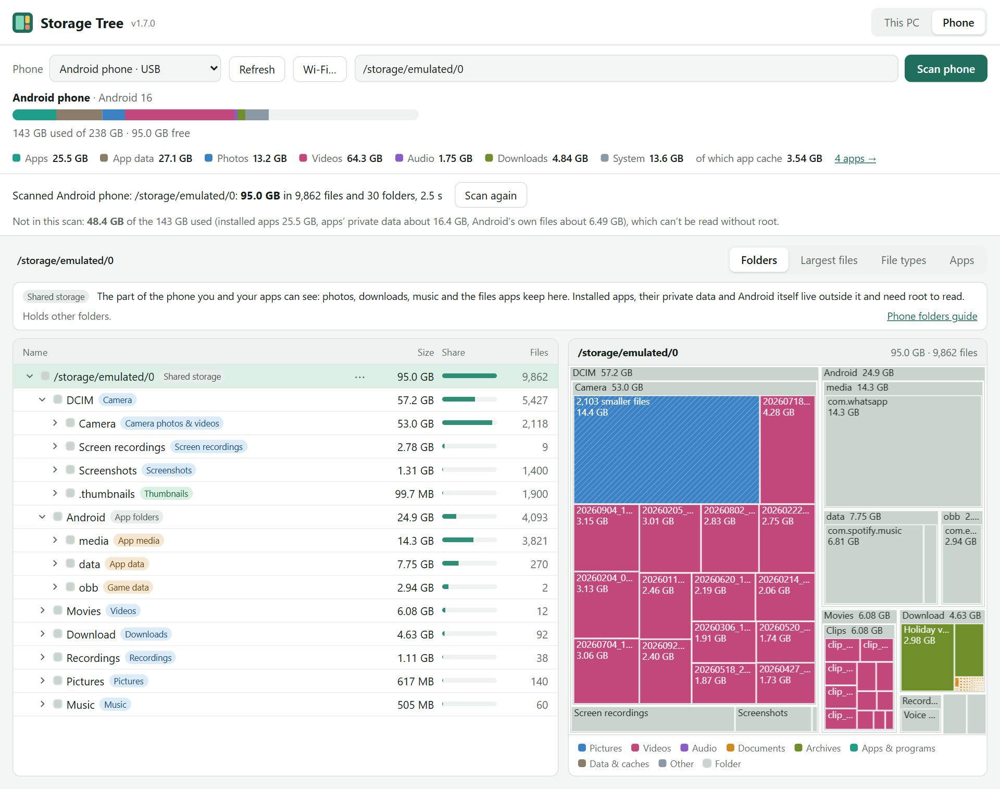
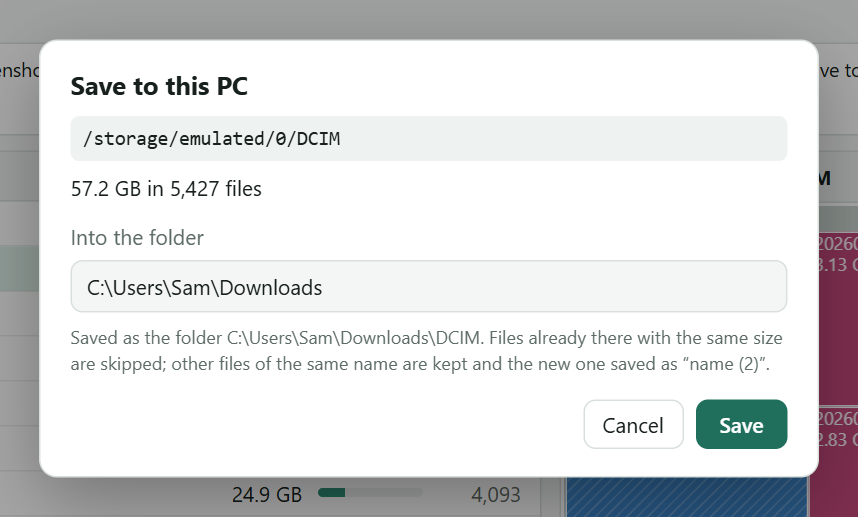
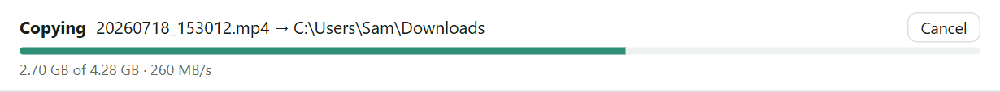
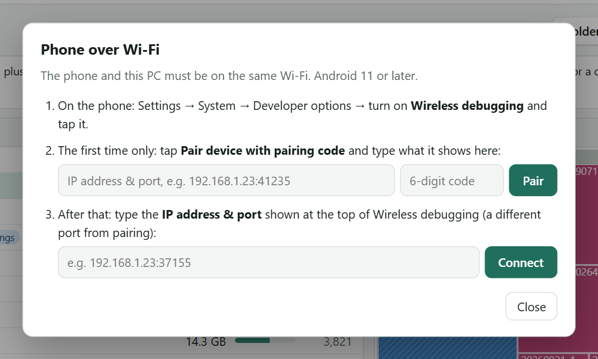

# Storage Tree

See what fills a disk, on this PC or on an Android phone, and clear it out.

**[Download for Windows](https://github.com/kenny-wong/storage-tree/releases/latest)** · Windows 10 or 11 (64-bit) · free, nothing leaves your PC

<picture>
  <source media="(prefers-color-scheme: dark)" srcset="docs/images/pc-dark.png">
  
</picture>

## Quick guide

- [Install](#1-install)
- [See what fills this PC](#2-see-what-fills-this-pc)
- [Delete what you don't need](#3-delete-what-you-dont-need)
- [Scan a phone](#4-scan-a-phone)
- [Save phone files to this PC](#5-save-phone-files-to-this-pc)

### 1. Install

1. Download `Storage-Tree-Setup-<version>.exe` from [Releases](https://github.com/kenny-wong/storage-tree/releases/latest) and run it. It installs for your Windows account only.
2. The installer isn't code-signed, so Windows may show "Windows protected your PC". Click **More info → Run anyway**.
3. Open **Storage Tree** from the Start menu or the desktop.

To update, run a newer installer over the old one.

### 2. See what fills this PC

1. On **This PC**, click a drive, or type a folder and press **Scan**. Results fill in while it scans.
2. Look for big boxes in the treemap. Click a folder to open it; the path above the list takes you back up.
3. Switch between **Folders**, **Largest files** and **File types** above the treemap. Each shows the folder you have open.

Striped boxes are many small files together. **Include protected folders** also reads folders only an administrator may open, so Windows may ask for permission after the scan. Nothing is changed.

### 3. Delete what you don't need

Right-click a file or folder (in the lists or the treemap), or use its **⋯** button, and choose **Move to Recycle Bin…**. The totals update without scanning again. **Show in Explorer** lets you look first.



> [!WARNING]
> A phone has no Recycle Bin: there the choice is **Delete from phone…** and it can't be undone. The app says so before it deletes. Save what you want to keep first.

### 4. Scan a phone

1. Turn on USB debugging and connect the phone ([how](#phones)).
2. Choose **Phone** at the top right. Your phone and its storage appear; if not, press **Refresh**.
3. Press **Scan phone**.



The tags say what the usual folders hold:

| Tag colour | What it means |
|---|---|
| Blue | Your files: copy them to the PC before deleting |
| Orange | An app's files: clear them in the app or in Settings › Apps › Storage |
| Green | Safe to clear: made again when needed, or already deleted items |
| Grey | Holds other folders |

**Phone folders guide** explains the whole layout, and **Apps** lists the size of every app.

### 5. Save phone files to this PC

1. Right-click a phone file or folder, or use its **⋯** button, and choose **Save to PC…**.
2. Choose the folder on this PC and press **Save**.



Progress shows at the top, with **Cancel** and, when it is done, **Show in Explorer**:



Files already there with the same size are skipped, so you can save again to finish a stopped copy. Nothing is overwritten: a different file with the same name is kept and the new one saved as "name (2)". You can also drag a phone file from the list into Explorer.

## Phones

First, on the phone: **Settings → About phone** (on some phones **Software information** inside it) and tap **Build number** 7 times. This shows **Developer options** in Settings.

**USB (fastest)**

1. Developer options → turn on **USB debugging**.
2. Connect the cable and tap **Allow** on the phone.

**Wi-Fi** (Android 11 or later, phone and PC on the same network)

1. Developer options → turn on **Wireless debugging** and tap it.
2. In the app, press **Wi-Fi…**. The first time, tap **Pair device with pairing code** on the phone and type its address and code; the app then connects by itself.
3. Later, type the address shown at the top of Wireless debugging and press **Connect**.



A phone connected both ways shows once and uses USB. Phones are read through adb (Android Debug Bridge), which is much faster than File Explorer's connection and comes with the installer.

**What a phone scan can't see:** installed apps, their private data and Android's own files need root, so a scan covers shared storage (photos, videos, downloads, chat media and so on). A line after the scan says how much space that leaves out. Recent Android versions may also hide `Android/data` and `Android/obb`; the scan lists any place it could not read.

## If something doesn't work

| Problem | Try |
|---|---|
| "No phone found" | Turn on USB debugging, use a cable that carries data, choose "File transfer" if the phone asks, then press **Refresh** |
| "The phone has not allowed this PC yet" | Unlock the phone and tap **Allow** on its "Allow USB debugging?" question |
| A scan says "Incomplete" | The connection dropped part way: check the cable and scan again |
| Some places could not be read | On a PC, use **Include protected folders**. On a phone, Android keeps them private to their apps |
| Wi-Fi won't connect | The port changes: type the address Wireless debugging shows now, not the pairing one |

The screenshots show made-up files.

## Running from the source

Windows 10/11 and [Node.js](https://nodejs.org/) 24 or later. No npm packages are needed to run it; Electron and electron-builder are only for the desktop app and its installer. For phones, install platform-tools (`winget install Google.PlatformTools`); the Android SDK's copy is found automatically, or set `ADB` to adb.exe.

```
npm start      # the app on http://127.0.0.1:8850 in a Chrome app window
npm run dev    # the same without opening Chrome, restarting when files change
npm test       # unit tests (Node's built-in test runner)
npm install    # once, before the two below
npm run app    # the desktop (Electron) version from the source, on port 8852
npm run dist   # the Windows installer in dist/ (draws the icon, copies this PC's adb)

node scripts/screenshots.mjs   # retakes the pictures in docs/images (needs Chrome)
```

## How it works

- `server.js`: a small HTTP server on 127.0.0.1 only; the API refuses other hosts and cross-site writes.
- `lib/scan-local.js`: walks a folder with many reads at once (`readdir` + `lstat`), not following links or junctions.
- `lib/scan-phone.js`: runs `find -H <folder> -print0 | xargs -0 stat -c '%f|%s|%Y|%n'` on the phone through `adb shell` and reads the lines as they arrive (a closing marker line tells a finished list from one cut off by a dropped connection, which is shown as incomplete); falls back to `du -a -k` on phones that can't.
- `lib/adb.js`: finds adb and parses `adb devices -l`, `df -k`, `dumpsys diskstats`, `adb pair`, `adb connect` and `adb mdns services`; merges a phone's USB and Wi-Fi entries by its serial number.
- `lib/tree.js`: the folder tree, totals, largest files and file types, and taking deleted entries out. Scans are kept in memory (the newest 3, plus the newest of each source, so the This PC and Phone tabs each go back to their own last scan).
- `lib/robocopy.js`: Windows' robocopy in list-only mode (`/L`, Unicode log): locked files by name without special rights, and the protected folders in backup mode (`/B`) from one PowerShell started with `-Verb RunAs`.
- `lib/remove.js`: the Recycle Bin (Windows' `SHFileOperation` through PowerShell) and `rm -rf` on a phone.
- `lib/pull.js` and `lib/tasks.js`: copies from a phone, one `adb pull` per file, a few at a time, each written under a temporary `storagetree-….part` name and renamed when complete; a PC name is held while a file is saved to it, so two phone files that become the same Windows name are both kept; background tasks with progress and cancel.
- `public/`: the page (plain HTML, CSS and ES modules); `treemap.js` is a squarified treemap layout drawn on a canvas. Dragging a phone file out uses Chrome's `DownloadURL` drag, which fetches the file from the phone as it is dropped.
- `electron/`: the desktop app, running the same server in its own window (port 8851).
- `scripts/screenshots.mjs`: runs the real server and page with a made-up drive and phone in headless Chrome and saves the pictures in `docs/images`.
